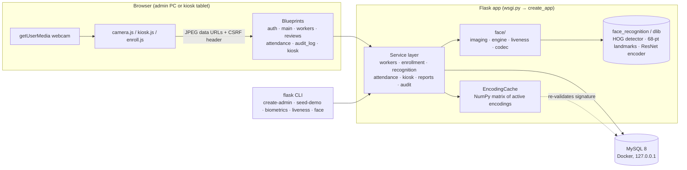
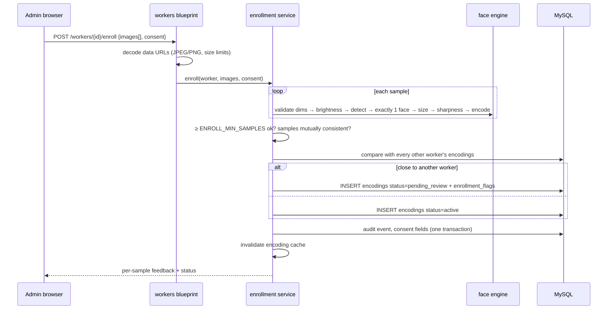

# Architecture

## Overview



The camera runs in the **browser**. The server never opens the user's webcam: browser frames are posted to the backend, which works the same whether the server runs on the same PC or elsewhere. The only server-side camera use is the optional diagnostic `flask face check-camera`, which reads a webcam attached to the machine running the command, through OpenCV.

## Layers

| Layer | Responsibility | Notes |
|---|---|---|
| `app/__init__.py` | Application factory: config, extensions, blueprints, CLI, error handlers, security headers | `create_app(config_name, config_overrides=, face_engine=)`. Tests inject a fake engine |
| `app/config.py` | `DevelopmentConfig`, `ProductionConfig`, `TestingConfig`; `validate_config` | Reads env at construction time; refuses placeholder secrets |
| `app/blueprints/` | HTTP: parse input, call services, render or return JSON | Admin blueprints use a `before_request` login check |
| `app/services/` | Business rules, transactions, audit events | No Flask request objects except audit IP capture |
| `app/face/` | Image validation and quality (Pillow/OpenCV), engine wrapper, liveness heuristics, safe codec | Pure functions where possible |
| `app/models.py` | SQLAlchemy 2.0 models | Constraint naming convention for portable migrations |

## Key flows

### Enrollment



### Kiosk attendance

```mermaid
sequenceDiagram
  participant K as Kiosk browser
  participant S as kiosk blueprint/service
  participant DB as MySQL
  K->>S: POST /kiosk/api/challenge {mode}
  S->>DB: INSERT liveness_challenges (sha256(token), session id, type, mode, expires_at)
  S-->>K: token, instruction ("blink slowly…"), frame plan
  K->>K: capture 16 frames ~180 ms apart
  K->>S: POST /kiosk/api/verify {token, mode, frames[]}
  S->>DB: UPDATE … SET consumed_at WHERE token_hash=? AND consumed_at IS NULL AND session=? AND mode=? AND expires_at>=now
  Note over S,DB: rowcount 1 = first and only use; else expired/replayed/invalid
  S->>S: per frame: quality, exactly one face, encoding, landmarks
  S->>S: match sequence (all matched frames agree, no ambiguous frame)
  S->>S: liveness heuristic for the issued challenge
  S->>DB: check-in INSERT (UNIQUE worker+date) / check-out conditional UPDATE
  S-->>K: recorded / already_checked_in / unknown_face / …
```

## Design decisions

| Decision | Rationale |
|---|---|
| Browser captures, server recognises | The server's webcam is not the user's webcam; works for remote kiosks; nothing to install on kiosk devices |
| Native Flask + MySQL in Docker | Browser webcam access needs no camera passthrough into containers; dlib builds natively |
| Face engine behind a small interface | Lets tests use mocked encodings deterministically; swapping engines later doesn't touch services |
| Duplicate prevention in the database | `UNIQUE(worker_id, business_date)` and a conditional `UPDATE` stay correct with many processes and threads; application checks alone are racy |
| Encodings as raw float64 bytes | Deterministic 1024-byte format; `np.frombuffer` with a length check; no `pickle` |
| No raw photos by default | Minimises biometric data held; templates are enough for matching |
| Cache re-validated by an aggregate signature | `COUNT/MAX/SUM(id)` of active encodings for active workers is cheap and detects enrollments, deletions and (de)activation from any process or CLI |
| Admin corrections are separate methods | `check_in_method`/`check_out_method` = `face` or `admin`, plus `is_corrected`; original values in `audit_events` |
| Overnight shifts rejected in v1 | Business date = local check-in date; closing a record after midnight needs an admin correction, explained to the worker |
| Bootstrap vendored, strict CSP | No third-party CDN at runtime; `script-src 'self'`; no inline scripts |
| Kiosk device enrollment | One-time activation code (hash stored), revocable; device sessions cannot reach admin pages |
