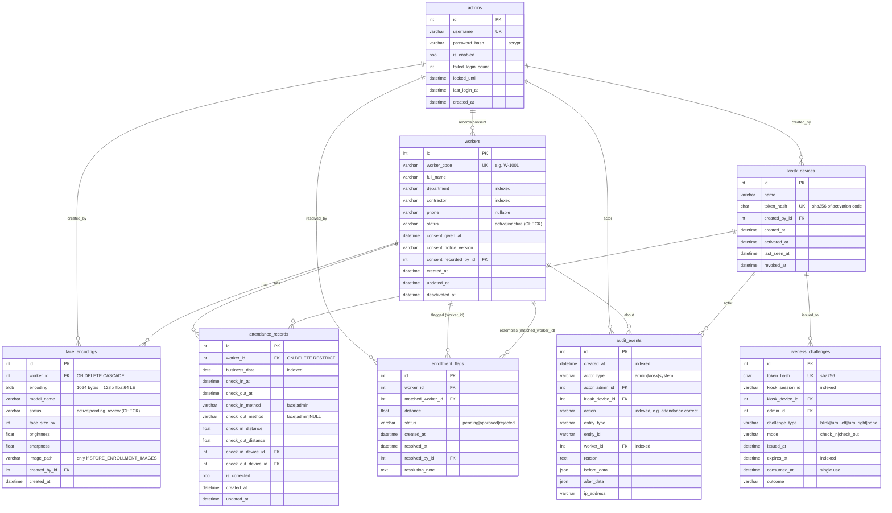

# Database schema

MySQL 8.0 (InnoDB, `utf8mb4`). Managed by Alembic migrations in [`migrations/`](../migrations/versions/0001_initial_schema.py). All timestamps are **naive UTC** in `DATETIME(6)` (microsecond precision). They are converted to `BUSINESS_TIMEZONE` only for display and for computing the business date.



## Constraints and indexes

| Table | Constraint / index | Purpose |
|---|---|---|
| `workers` | `uq_workers_worker_code` | Unique worker IDs (codes are upper-cased before insert) |
| `workers` | `ck_workers_status_valid` | Only `active`/`inactive` |
| `attendance_records` | **`uq_attendance_worker_date (worker_id, business_date)`** | One record per worker per business day; rejects concurrent duplicate check-ins |
| `attendance_records` | `ck_..._checkout_after_checkin` | `check_out_at IS NULL OR check_out_at >= check_in_at` (MySQL ≥ 8.0.16 enforces CHECK) |
| `attendance_records` | `ck_..._check_in_method_valid`, `..._check_out_method_valid` | Distinguish `face` from `admin` entries |
| `attendance_records` | FK `worker_id` **RESTRICT** | A worker with attendance history can't be deleted; they are deactivated instead |
| `face_encodings` | FK `worker_id` CASCADE, `ix_face_encodings_status_worker` | Fast load of active encodings |
| `liveness_challenges` | `uq_..._token_hash`, `ix_..._expires_at`, `ix_..._kiosk_session_id` | Lookup by hashed token and pruning |
| `kiosk_devices` | `uq_kiosk_devices_token_hash` | Activation by hashed code |
| `audit_events` | `ix_..._created_at`, `ix_..._action`, `ix_..._worker_id`, `ix_audit_events_entity` | Audit filtering |

## Duplicate prevention at the database level

- **Check-in** is a plain `INSERT`. If two kiosks recognise the same worker at the same moment, InnoDB serialises the two inserts on the unique key. The first commits and the second fails with error 1062 (duplicate key), which the service turns into "Already checked in today at HH:MM". No application-level lock is needed, and it holds across processes and servers.
- **Check-out** is one statement: `UPDATE attendance_records SET check_out_at=… WHERE worker_id=? AND business_date=? AND check_out_at IS NULL AND check_in_at <= ?`. Only the first concurrent request matches the row (`rowcount = 1`). The rest see `check_out_at` set and get "Already checked out".
- **Liveness challenges** are consumed with `UPDATE … SET consumed_at=now WHERE token_hash=? AND consumed_at IS NULL AND kiosk_session_id=? AND mode=? AND expires_at >= now`. A token works once, even under concurrent replay.

These guarantees are tested against MySQL in [`tests/test_mysql_concurrency.py`](../tests/test_mysql_concurrency.py), with 12 threads racing through a barrier.

## Serialization of encodings

`face_encodings.encoding` is exactly 1024 bytes: 128 little-endian IEEE-754 float64 values (`numpy.ndarray.tobytes()` with dtype `<f8`). Reading uses `numpy.frombuffer(blob, dtype='<f8')` after checking the length is 1024 and the values are finite. `pickle`, `np.load(allow_pickle=True)` or any other code-executing format is never used.

## Migrations

```bash
flask --app wsgi db upgrade                 # apply
flask --app wsgi db downgrade               # step back one revision
flask --app wsgi db migrate -m "message"    # autogenerate after model changes, then REVIEW the file
flask --app wsgi db current                 # show applied revision
```

`tests/test_migrations.py` applies all migrations to an empty database, checks with Alembic's `compare_metadata` that the result matches the models exactly, then downgrades to base.

## Backups

Database dumps contain biometric templates and personal data. Store them encrypted and with access control, and never in the repository (`*.sql`, `*.dump` are git-ignored). Example: `docker exec wfa-mysql mysqldump -uroot -p --single-transaction worker_attendance | gpg -c > backup.sql.gpg`.
